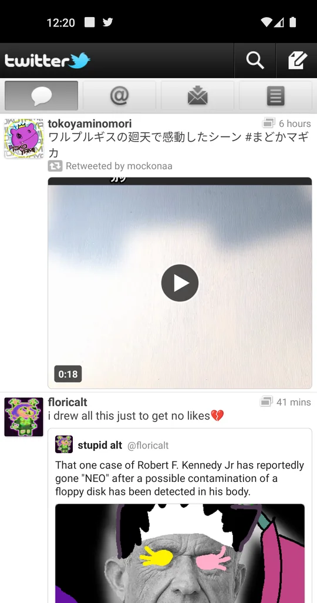
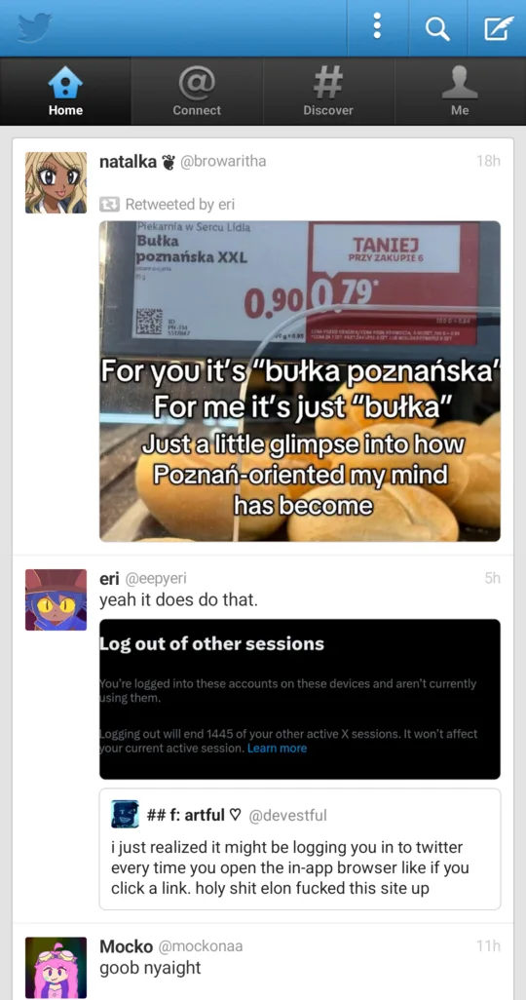
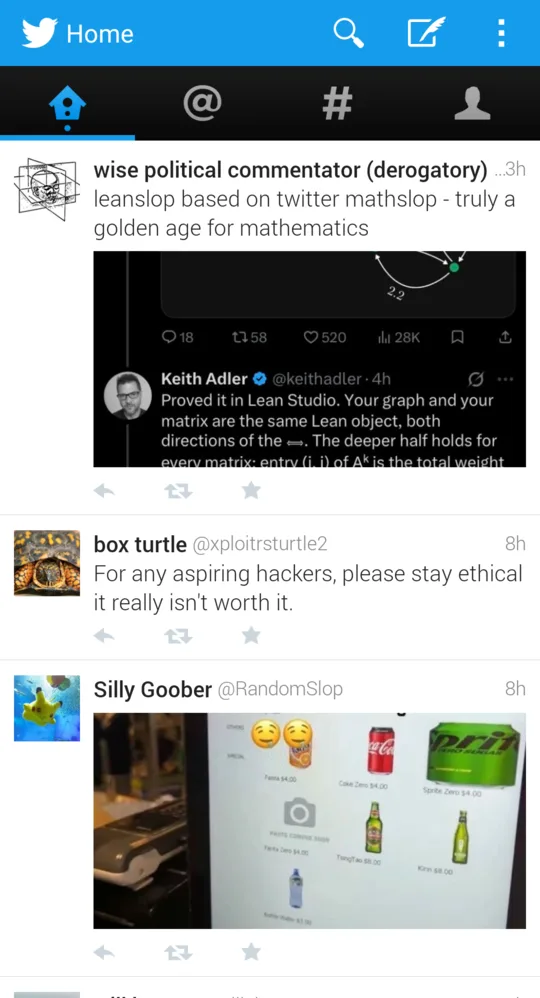

# Install on your phone

This guide assumes the server is already running. If it isn't, [download and run it](../server/README.md) first.

## 1. Pick a design

| `twitter-revival-2011.apk`                                | `twitter-revival-2012.apk`                                | `twitter-revival-2014.apk`                                |
| ----------------------------------- | ----------------------------------- | ----------------------------------- |
|  |  |  |

You can also install multiple at once if you'd like.

## 2. Install it

1. Download the APK matching the design you picked on your phone, from the [releases page](https://github.com/tiagozip/twitter-revival/releases).
2. Open the downloaded file.
3. The first time, Android says your browser isn't allowed to install apps. Tap **Settings**, turn on **Allow from this source**, and go back.
4. Tap **Install**.

If Play Protect warns about the app, tap **More details** and then **Install anyway**. It warns because the app is signed with a key it doesn't recognize.

## 3. Enter your server address

The first launch asks for your server's address.

- **Same Wi-Fi as the computer running the server:** use the computer's local IP and port, like `192.168.1.20:7171`. On a Mac, hold Option and click the Wi-Fi icon to see the IP. On Windows, run `ipconfig`. On Linux, run `hostname -I`.

- **Anywhere else:** put the server behind HTTPS and enter that address, like `https://revival.example.com`. See [reaching the server from outside](../server/README.md#reach-it-from-outside-your-home).

You can change it later from the app's menu, under **Revival server…**

## 4. Sign in

- **Username:** anything, such as your X username.
- **Password:** your X `auth_token` cookie, explained below.

The server checks the token with X and gives the app a sealed session in return. The token isn't written to disk.

If the person running the server set `REVIVAL_PASSWORD`, you can type that password instead of a token, and you'll be signed in to the server owner's account.

### Find your auth_token

The `auth_token` is a 40 character code that X keeps in your browser after you log in. You can copy it on a computer:

1. Open [x.com](https://x.com) in Chrome, Edge, Brave or Firefox and log in.
2. Press F12, or Cmd+Option+I on a Mac, to open the developer tools.
3. Chrome, Edge and Brave: open the **Application** tab, then **Cookies** in the left sidebar, then `https://x.com`. Firefox: open the **Storage** tab, then **Cookies**, then `https://x.com`.
4. Find the row named `auth_token` and copy its value. It looks like `a1b2c3d4e5f6...`, letters a to f and numbers only.

**Do not share this with anyone!** Treat it like a password. Anyone with it can use your account.

**The person running the revival server will also get your auth token**, so be very careful and make sure you trust them.

## Problems

**"Revival server unreachable"**
The phone can't reach the server. Check that the server is still running, that the phone is on the same Wi-Fi, and that the address has the right IP and `:7171`.

Some routers block devices from talking to each other on guest networks. In that case, use a QuickTunnel or ngrok server instead.

**"Set up your Twitter Revival server first"**
No server address is saved yet. Open the menu and pick **Revival server…**

**"Use your X auth_token as the password"**
The password wasn't a valid token. Copy the `auth_token` value again, without spaces or quotes.

**The timeline is empty after signing in**
Pull down to refresh. If it stays empty, look at the server's terminal for an error line.

**The app was installed but now says it can't update**
The new APK was signed with a different key. Uninstall the old one first.
